# Bản đồ workflow Cún Zoom

Đọc từ trên xuống: cài ứng dụng → kết nối → theo dõi lịch → ghi buổi được phép → đọc bài giảng. Bản đồ này dùng graph của **Understand Anything**; mỗi bước bên dưới có đường dẫn tới mã thực hiện.

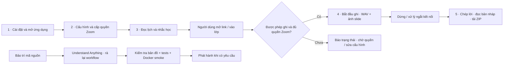

**Điểm cần nhớ:** bản Windows tự mở link lớp, bản Docker chỉ đưa link tới giao diện; cả hai đều không tự vào phòng hoặc tự ghi. Ghi cần OAuth/OBF, người cấp quyền có mặt và host cho phép. Bản Linux đã kiểm tra build/SDK init; OAuth và ghi phòng thật chưa được xác minh. RTMS chưa có.

## Các luồng và bước thực hiện

### Cài đặt và vận hành

Đưa ứng dụng local vào hoạt động trên Windows (CunZoom.exe) hoặc Docker, kiểm tra trước phát hành và bảo toàn dữ liệu khi cập nhật. Không bản phát hành nào chứa Zoom SDK: người dùng tự tải SDK chính thức và cài vào ứng dụng (Windows) hoặc mount (Docker).

<details>
<summary>Khởi động Docker và kiểm tra bộ ghi</summary>

Chuẩn bị môi trường local, tái sử dụng worker đúng SDK và mở giao diện ngay cả khi thiếu bộ ghi.

**Bắt đầu:** docker compose up -d --build

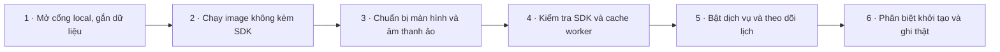

| Bước | Thực hiện | Mã nguồn |
| --- | --- | --- |
| 1. Mở cổng local, gắn dữ liệu | Compose giữ dữ liệu trong volume, gắn SDK chỉ đọc và bỏ capabilities; không mở cổng ra toàn mạng. | [compose.yaml](../compose.yaml#L4) |
| 2. Chạy image không kèm SDK | Image cài thư viện cần thiết và chạy UID 10001; nguồn SDK không được chép vào image. | [Dockerfile](../Dockerfile#L11) |
| 3. Chuẩn bị màn hình và âm thanh ảo | Supervisor chạy Xvfb và PulseAudio nội bộ, không lấy micro/camera của máy host. | [scripts/container_entry.py](../scripts/container_entry.py#L10) |
| 4. Kiểm tra SDK và cache worker | Băm SDK/header/mã worker để biên dịch lại khi thay đổi; thiếu SDK hoặc build lỗi xóa worker và giữ UI. | [scripts/container_entry.py](../scripts/container_entry.py#L46) |
| 5. Bật dịch vụ và theo dõi lịch | Tạo mật khẩu local, khởi động HTTP cùng watcher; tín hiệu dừng đưa dịch vụ qua luồng đóng an toàn. | [src/container_main.py](../src/container_main.py#L13) |
| 6. Phân biệt khởi tạo và ghi thật | Hồ sơ kiểm thử xác nhận compile/link và InitSDK; OAuth/OBF, âm thanh và slide Docker trong phòng thật chưa kiểm tra. | [docs/VALIDATION.md](../docs/VALIDATION.md#L14) |

</details>

<details>
<summary>Rà bản đồ, kiểm tra và phát hành phiên bản</summary>

Rà bản đồ, chạy tests trên Linux và Windows, build và tự kiểm tra CunZoom.exe, build/smoke Docker rồi chỉ phát hành khi được yêu cầu và mọi bước đạt.

**Bắt đầu:** /workflow và AGENTS.md → GitHub Actions: push, pull_request hoặc workflow_dispatch

```mermaid
flowchart LR
  s1["1 · Rà và tái tạo bản đồ trước khi gửi CI"]
  s2["2 · Đồng bộ mục lục bàn giao và skill"]
  s1 --> s2
  s3["3 · Kiểm tra nguồn trước CI"]
  s2 --> s3
  s4["4 · CI chặn bản đồ lệch trước tests"]
  s3 --> s4
  s5["5 · Build và tự kiểm tra CunZoom.exe"]
  s4 --> s5
  s6["6 · Chạy tests, build và kiểm tra HTTP thật"]
  s5 --> s6
  s7["7 · Chặn sai hoặc trùng phiên bản"]
  s6 --> s7
  s8["8 · Đẩy image đã kiểm tra"]
  s7 --> s8
  s9["9 · Đóng gói và tạo Release"]
  s8 --> s9
```

| Bước | Thực hiện | Mã nguồn |
| --- | --- | --- |
| 1. Rà và tái tạo bản đồ trước khi gửi CI | Áp dụng /workflow cùng understand-domain --full để phân tích lại nguồn; gọi refresh với đúng plugin ghim. Công cụ dùng validator gốc, sinh graph/tài liệu và snapshot; đây là bảo trì chủ động, CI không tự phân tích AI. | [scripts/workflow_map.py](../scripts/workflow_map.py#L320) |
| 2. Đồng bộ mục lục bàn giao và skill | Dùng docs/HANDOVER.md làm điểm tìm cơ chế, nguồn, cài đặt, vận hành, kiểm chứng và skill /workflow. Bàn giao nguồn, graph và tài liệu trên đúng repo được phép; giữ SDK, khóa và dữ liệu học ngoài GitHub. Chỉ xác nhận đã đưa lên GitHub sau khi kiểm tra kết quả publish. | [docs/HANDOVER.md](../docs/HANDOVER.md#L1) |
| 3. Kiểm tra nguồn trước CI | CI cài phụ thuộc và chạy check_source để chặn dữ liệu riêng hoặc SDK trước các chốt bản đồ, kiểm thử và build. | [.github/workflows/docker-release.yml](../.github/workflows/docker-release.yml#L22) |
| 4. CI chặn bản đồ lệch trước tests | Ngay sau check_source, CI gọi workflow_map.py check để đối chiếu fingerprint nguồn/artifact và kiểm tra graph. Bản đồ thiếu, đường dẫn sai hoặc nội dung lệch phải sửa và refresh trước khi tiếp tục unit/integration/JavaScript. | [.github/workflows/docker-release.yml](../.github/workflows/docker-release.yml#L32) |
| 5. Build và tự kiểm tra CunZoom.exe | Tests trên Windows, lấy SDK Windows từ kho riêng và đối chiếu SHA-256, biên dịch worker, đóng gói exe không kèm SDK, chạy --self-test với SDK đặt ngoài và từ chối exe chứa SDK; giữ exe làm artifact. | [.github/workflows/docker-release.yml](../.github/workflows/docker-release.yml#L38) |
| 6. Chạy tests, build và kiểm tra HTTP thật | Sau chốt bản đồ, chạy unit/integration, kiểm tra cú pháp JavaScript, build image không SDK rồi smoke HTTP thật; lỗi có diagnostics. | [.github/workflows/docker-release.yml](../.github/workflows/docker-release.yml#L112) |
| 7. Chặn sai hoặc trùng phiên bản | Chỉ publish khi dispatch được bật; đối chiếu phiên bản mã với input, từ chối tag đã tồn tại. | [.github/workflows/docker-release.yml](../.github/workflows/docker-release.yml#L140) |
| 8. Đẩy image đã kiểm tra | Đăng nhập GHCR bằng token workflow rồi đẩy tag phiên bản và latest từ image đã test. | [.github/workflows/docker-release.yml](../.github/workflows/docker-release.yml#L158) |
| 9. Đóng gói và tạo Release | Tải exe Windows đã kiểm tra, đóng gói source và SHA256SUMS, tạo một Release chung cho Windows và Docker. | [.github/workflows/docker-release.yml](../.github/workflows/docker-release.yml#L175) |

</details>

<details>
<summary>Sao lưu, khôi phục và cập nhật thủ công</summary>

Người vận hành giữ dữ liệu và khóa nhất quán trước khi thay phiên bản; quy trình này là hướng dẫn thao tác, không phải job tự động.

**Bắt đầu:** Người vận hành làm theo docs/OPERATIONS.md

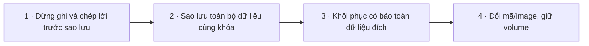

| Bước | Thực hiện | Mã nguồn |
| --- | --- | --- |
| 1. Dừng ghi và chép lời trước sao lưu | Đợi xử lý hoàn tất rồi dừng container để có bản sao nhất quán. | [docs/OPERATIONS.md](../docs/OPERATIONS.md#L52) |
| 2. Sao lưu toàn bộ dữ liệu cùng khóa | Đóng gói /data gồm cấu hình, khóa, mô hình và lessons; bản sao phải giữ riêng vì có thông tin truy cập. | [docs/OPERATIONS.md](../docs/OPERATIONS.md#L56) |
| 3. Khôi phục có bảo toàn dữ liệu đích | Sao lưu volume đích trước thao tác có thể ghi đè; dùng đúng khóa, không chuyển thẳng DPAPI sang Linux. | [docs/OPERATIONS.md](../docs/OPERATIONS.md#L68) |
| 4. Đổi mã/image, giữ volume | Đọc release và sao lưu trước; cập nhật source hoặc tag image rồi tạo lại container, không xóa volume. | [docs/OPERATIONS.md](../docs/OPERATIONS.md#L80) |

</details>

<details>
<summary>Mở và nâng cấp bản Windows</summary>

Chạy CunZoom.exe một phiên duy nhất, nhận lại dữ liệu của bản 1.x trên cùng máy, mở cửa sổ và khay hệ thống, rồi để người dùng cài Zoom SDK của chính họ.

**Bắt đầu:** Mở CunZoom.exe

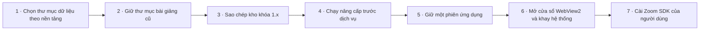

| Bước | Thực hiện | Mã nguồn |
| --- | --- | --- |
| 1. Chọn thư mục dữ liệu theo nền tảng | Windows dùng tiếp thư mục dữ liệu mặc định mà bản 1.x đã tạo trên máy, nếu không có thì dùng %LOCALAPPDATA%\CunZoom; Docker/Linux dùng thư mục được cấu hình. | [src/paths.py](../src/paths.py#L11) |
| 2. Giữ thư mục bài giảng cũ | Khi chưa chọn thư mục, bản desktop đọc lại vị trí bài giảng mặc định của 1.x; container luôn khóa vào /data/lessons. | [src/paths.py](../src/paths.py#L30) |
| 3. Sao chép kho khóa 1.x | Chỉ trên desktop: sao chép quyen_zoom.dpapi/calendar.dpapi sang zoom.vault/calendar.vault khi chưa có; file nguồn giữ nguyên. | [src/paths.py](../src/paths.py#L44) |
| 4. Chạy nâng cấp trước dịch vụ | Điểm vào gọi bước sao chép trước khi khởi tạo API, trừ khi chạy với --no-migrate (CI self-test). | [src/main.py](../src/main.py#L64) |
| 5. Giữ một phiên ứng dụng | Mutex Windows chặn mở hai bản; lần mở thứ hai yêu cầu bản đang chạy hiện cửa sổ. | [src/main.py](../src/main.py#L77) |
| 6. Mở cửa sổ WebView2 và khay hệ thống | Tạo API loopback, cửa sổ WebView2, biểu tượng khay và thông báo lịch; đóng cửa sổ chỉ thu gọn, Thoát mới dừng dịch vụ và bộ ghi. | [src/main.py](../src/main.py#L90) |
| 7. Cài Zoom SDK của người dùng | Người dùng chọn file ZIP Meeting SDK Windows chính thức; khi bot không chạy và thư mục SDK do ứng dụng quản lý, ứng dụng chỉ chép x64/bin vào zoom-sdk rồi thay bản cũ. | [src/sdk_setup.py](../src/sdk_setup.py#L47) |

</details>

### Truy cập và ủy quyền Zoom

Bảo vệ giao diện local và lưu cấu hình có mã hóa. Quyền OAuth của người dùng, xác thực Meeting SDK và quyền ghi của chủ phòng là các điều kiện riêng biệt.

<details>
<summary>Đăng nhập local và kết nối quyền Zoom</summary>

Người dùng lưu ứng dụng Zoom trên máy, hoàn tất OAuth PKCE và giữ token mã hóa; đây chưa phải quyền ghi trong cuộc họp.

**Bắt đầu:** POST /settings/zoom; POST /zoom/connect; GET /oauth/callback

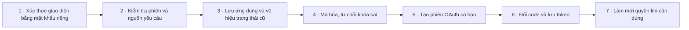

| Bước | Thực hiện | Mã nguồn |
| --- | --- | --- |
| 1. Xác thực giao diện bằng mật khẩu riêng | Docker so sánh username cunzoom và mật khẩu local; mật khẩu được tạo ngẫu nhiên, giữ qua restart. | [src/access_control.py](../src/access_control.py#L12) |
| 2. Kiểm tra phiên và nguồn yêu cầu | Trước action POST phải qua Basic Auth, Host/token/Origin và JSON object dưới 65536 byte. | [src/server.py](../src/server.py#L372) |
| 3. Lưu ứng dụng và vô hiệu trạng thái cũ | Kiểm tra độ dài thông tin, giữ secret khi ô trống, loại OAuth khi đổi Client ID và đặt lại kết quả SDK khi thông tin SDK thay đổi. | [src/server.py](../src/server.py#L180) |
| 4. Mã hóa, từ chối khóa sai | Windows dùng DPAPI, Linux dùng Fernet; ghi thay thế nguyên tử và báo lỗi khi mất/sai khóa, không ghi bản rõ. | [src/vault.py](../src/vault.py#L11) |
| 5. Tạo phiên OAuth có hạn | Tạo state cùng PKCE S256; Docker dùng callback của PUBLIC_ORIGIN, phiên hết hạn sau 600 giây. | [src/server.py](../src/server.py#L113) |
| 6. Đổi code và lưu token | Xác minh state/hạn, xử lý việc chưa cấp quyền, chỉ mã hóa kết quả khi có đủ access và refresh token. | [src/server.py](../src/server.py#L139) |
| 7. Làm mới quyền khi cần dùng | Trước khi vào phòng, dùng access token còn hạn hoặc đổi refresh token và lưu lại; thiếu token yêu cầu kết nối lại. | [src/runner.py](../src/runner.py#L35) |

</details>

### Theo dõi lịch học

Đọc lịch Google dạng iCal, lọc các buổi có một phòng Zoom rõ ràng và nhắc người dùng. Trong Docker, lịch chỉ chuyển thông báo và liên kết tới giao diện đang mở; không tự tham gia hoặc ghi.

<details>
<summary>Kết nối và đồng bộ nguồn lịch học</summary>

Xác nhận lịch của người dùng, lọc buổi Zoom theo từ khóa và giữ trạng thái lỗi trung thực.

**Bắt đầu:** POST /calendar/configure; POST /calendar/sync

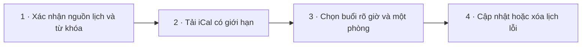

| Bước | Thực hiện | Mã nguồn |
| --- | --- | --- |
| 1. Xác nhận nguồn lịch và từ khóa | Yêu cầu đúng iCal Google, có từ khóa và xác nhận tài khoản; mã hóa cấu hình rồi xóa sự kiện cũ. | [src/calendar_watch.py](../src/calendar_watch.py#L142) |
| 2. Tải iCal có giới hạn | Chỉ nhận HTTPS calendar.google.com /basic.ics, không chuyển hướng; chặn lịch quá lớn và che địa chỉ bí mật trong lỗi. | [src/calendar_watch.py](../src/calendar_watch.py#L28) |
| 3. Chọn buổi rõ giờ và một phòng | Mở rộng định kỳ 14 ngày, quy về Asia/Bangkok, bỏ cả ngày/hủy/quá hạn và các buổi có nhiều phòng; khử trùng bằng khóa. | [src/calendar_watch.py](../src/calendar_watch.py#L73) |
| 4. Cập nhật hoặc xóa lịch lỗi | Lỗi tải/đọc làm rỗng danh sách, không giữ phòng cũ; chỉ nhận kết quả khi cấu hình nguồn chưa thay đổi. | [src/calendar_watch.py](../src/calendar_watch.py#L173) |

</details>

<details>
<summary>Nhắc học và chuyển liên kết tới người dùng</summary>

Watcher nhắc trước 30 phút và tùy chọn chuyển link trước 2 phút; Docker chỉ hiển thị trong trình duyệt đang mở, không tự vào hoặc ghi.

**Bắt đầu:** Watcher.run: đồng bộ 300 giây, tick 15 giây; POST /calendar/open

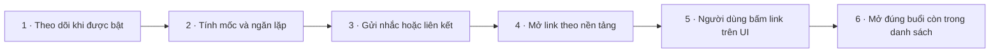

| Bước | Thực hiện | Mã nguồn |
| --- | --- | --- |
| 1. Theo dõi khi được bật | Chỉ hoạt động khi bật và có feed, đồng bộ khoảng 5 phút rồi tick; lỗi tạm dừng được báo để người dùng đồng bộ lại. | [src/calendar_watch.py](../src/calendar_watch.py#L240) |
| 2. Tính mốc và ngăn lặp | Chọn nhắc trong 30 phút, tùy chọn open từ 2 phút trước đến 10 phút sau giờ; lưu đánh dấu trước tác động. | [src/calendar_watch.py](../src/calendar_watch.py#L205) |
| 3. Gửi nhắc hoặc liên kết | Gửi thông báo; hành động open chuyển link và nhắc người dùng vào Zoom trước khi xác nhận bắt đầu bot. | [src/calendar_watch.py](../src/calendar_watch.py#L229) |
| 4. Mở link theo nền tảng | Windows mở link lớp bằng ứng dụng mặc định; Docker không chạy lệnh trên host mà đưa link vào hàng sự kiện cho giao diện. | [src/platform_actions.py](../src/platform_actions.py#L11) |
| 5. Người dùng bấm link trên UI | Giao diện hiển thị liên kết HTTPS và toast từ sự kiện mới; cần UI đang mở để nhận, không replay backlog khi mới tải. | [web/app.js](../web/app.js#L76) |
| 6. Mở đúng buổi còn trong danh sách | API lấy sự kiện theo khóa hiện tại; Docker trả URL cho giao diện, desktop mở link trực tiếp. | [src/server.py](../src/server.py#L175) |

</details>

### Ghi buổi học được phép

Quản lý quá trình xác thực SDK, yêu cầu vào đúng phòng, xin quyền ghi và thu dữ liệu thực tế. Luồng đã được cài đặt trong mã nhưng bản Docker chưa xác minh OAuth, âm thanh và slide trong phòng thật.

<details>
<summary>Kiểm tra SDK rồi yêu cầu vào phòng thủ công</summary>

Yêu cầu xác nhận ghi, kiểm tra ID/link và quyền OBF của người đã vào lớp; không có luồng tự vượt quyền hoặc vào trước tài khoản OBF.

**Bắt đầu:** POST /sdk-test; POST /start-bot

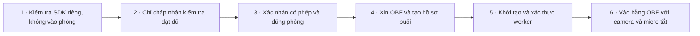

| Bước | Thực hiện | Mã nguồn |
| --- | --- | --- |
| 1. Kiểm tra SDK riêng, không vào phòng | API gọi worker ở chế độ auth-test; native xác thực SDK và thoát khi chỉ kiểm tra. | [src/server.py](../src/server.py#L198) |
| 2. Chỉ chấp nhận kiểm tra đạt đủ | Runner chỉ lưu auth_test_passed khi SDK khởi tạo, xác thực đều thành công và tiến trình thoát 0. | [src/runner.py](../src/runner.py#L97) |
| 3. Xác nhận có phép và đúng phòng | Chặn nếu chưa consent/chưa kiểm tra SDK; chuẩn hóa ID, từ chối ID khác link trước khi làm mới OAuth. | [src/server.py](../src/server.py#L214) |
| 4. Xin OBF và tạo hồ sơ buổi | Chặn worker trùng, kiểm tra tên/ID/mật khẩu; xin OBF cho tài khoản OAuth đang ở phòng, sau đó tạo thư mục môn/buổi. | [src/runner.py](../src/runner.py#L44) |
| 5. Khởi tạo và xác thực worker | Nhận thông tin qua stdin riêng, bắt buộc OBF ở chế độ join; InitSDK và yêu cầu xác thực SDK. | [native/linux_bot.cpp](../native/linux_bot.cpp#L124) |
| 6. Vào bằng OBF với camera và micro tắt | Sau xác thực, cấu hình micro ảo im lặng, Join có OBF, tắt video/audio; lỗi join kết thúc quá trình. | [native/linux_bot.cpp](../native/linux_bot.cpp#L116) |

</details>

<details>
<summary>Xin quyền, ghi dữ liệu và dừng an toàn</summary>

Worker chờ chủ phòng cấp quyền, lưu âm thanh và ảnh chia sẻ thực tế rồi đóng phiên khi dừng hoặc lỗi; chưa được xác minh trong phòng thật Docker.

**Bắt đầu:** Native meeting events; POST /stop-bot; SIGTERM

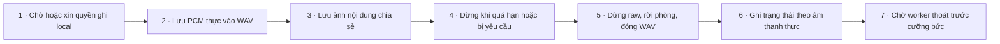

| Bước | Thực hiện | Mã nguồn |
| --- | --- | --- |
| 1. Chờ hoặc xin quyền ghi local | Chỉ StartRawRecording khi được phép; xin quyền một lần, nhận callback; từ chối/thu hồi quyền dẫn tới dừng. | [native/linux_bot.cpp](../native/linux_bot.cpp#L104) |
| 2. Lưu PCM thực vào WAV | Chỉ ghi buffer hợp lệ khi rawStarted, giữ header và đếm byte; lỗi ghi hoặc đổi định dạng dừng nhận. | [native/linux_bot.cpp](../native/linux_bot.cpp#L54) |
| 3. Lưu ảnh nội dung chia sẻ | Subscribe RAW_DATA_TYPE_SHARE và lưu JPEG giới hạn nhịp 30 giây, chiều rộng tối đa 1600; không chụp camera. | [native/linux_bot.cpp](../native/linux_bot.cpp#L72) |
| 4. Dừng khi quá hạn hoặc bị yêu cầu | Nhận STOP/tín hiệu; timeout xác thực 60 giây, vào phòng 180 giây, chờ ghi 300 giây và tổng phiên 3 giờ tính từ lúc bắt đầu. | [native/linux_bot.cpp](../native/linux_bot.cpp#L135) |
| 5. Dừng raw, rời phòng, đóng WAV | Ngừng subscribe và ghi, rời phòng, cập nhật WAV header rồi phát stopped kèm byte thực và dọn SDK. | [native/linux_bot.cpp](../native/linux_bot.cpp#L155) |
| 6. Ghi trạng thái theo âm thanh thực | Runner lưu lỗi, byte và slide vào hồ sơ; chỉ trạng thái có audio mới khởi chạy chép lời, không coi vào phòng là đã ghi. | [src/runner.py](../src/runner.py#L106) |
| 7. Chờ worker thoát trước cưỡng bức | STOP được gửi qua stdin; khi dịch vụ dừng, chờ 20 giây rồi terminate và chỉ kill nếu tiếp tục treo. | [src/runner.py](../src/runner.py#L53) |

</details>

### Chép lời và thư viện bài giảng

Sắp xếp bản ghi theo môn và buổi, chép lời local rồi cung cấp tài liệu để người học rà soát. Bản trích ý chỉ là bản nháp chọn câu, chưa đối chiếu slide và không thay thế xác nhận yêu cầu của giảng viên.

<details>
<summary>Chép lời local và tạo bản trích ý nháp</summary>

Sau buổi có âm thanh, dùng mô hình đã tải để tạo transcript và bản nháp cần người học rà soát.

**Bắt đầu:** POST /model/download; runner.read_events khi audio_bytes > 0

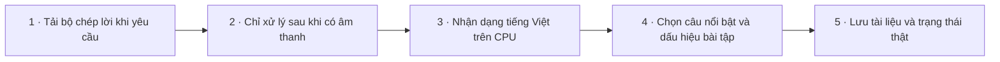

| Bước | Thực hiện | Mã nguồn |
| --- | --- | --- |
| 1. Tải bộ chép lời khi yêu cầu | Tải faster-whisper-base từ Hugging Face vào cache local; báo trạng thái tải, sẵn sàng hoặc thất bại. | [src/server.py](../src/server.py#L95) |
| 2. Chỉ xử lý sau khi có âm thanh | Runner khởi tiến trình transcribe cho thư mục buổi khi số byte đã nhận lớn hơn 0, ghi log vào buổi tương ứng. | [src/runner.py](../src/runner.py#L128) |
| 3. Nhận dạng tiếng Việt trên CPU | Đọc WAV/webm trong thư mục buổi; dùng Whisper base int8 local_files_only, ghi từng đoạn kèm thời gian. | [src/transcribe.py](../src/transcribe.py#L23) |
| 4. Chọn câu nổi bật và dấu hiệu bài tập | Quy tắc chấm điểm từ vựng chọn câu và dò cụm bài tập/hạn; nhãn bản nháp nêu rõ có thể sai, chưa đối chiếu slide. | [src/transcribe.py](../src/transcribe.py#L5) |
| 5. Lưu tài liệu và trạng thái thật | Lưu transcript, trích ý, hướng dẫn rà soát; completed ghi số đoạn, exception lưu failed rồi trả lỗi. | [src/transcribe.py](../src/transcribe.py#L38) |

</details>

<details>
<summary>Xem tài liệu và tải đúng buổi học</summary>

Thư viện lấy hồ sơ môn/buổi có thật, giới hạn đường dẫn và phục vụ ZIP qua giao diện đã đăng nhập.

**Bắt đầu:** POST /status; POST /library/read; POST /library/open; GET /library/download

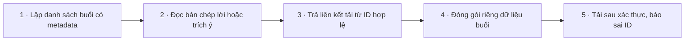

| Bước | Thực hiện | Mã nguồn |
| --- | --- | --- |
| 1. Lập danh sách buổi có metadata | Duyệt dưới recordings_root, bỏ symlink/thư mục ngoài phạm vi; ID băm, sắp mới trước và tối đa 300 buổi. | [src/library.py](../src/library.py#L11) |
| 2. Đọc bản chép lời hoặc trích ý | Tìm ID đã biết, chỉ nhận loại summary/transcript; xác minh tệp trong thư mục buổi và giới hạn 160000 ký tự. | [src/library.py](../src/library.py#L49) |
| 3. Trả liên kết tải từ ID hợp lệ | Docker kiểm tra buổi rồi trả URL nội bộ; desktop mở thư mục đã biết thay vì nhận đường dẫn tùy ý. | [src/server.py](../src/server.py#L231) |
| 4. Đóng gói riêng dữ liệu buổi | Chỉ đưa tệp thường trong buổi đã chọn vào ZIP, bỏ symlink và tệp nằm ngoài thư mục buổi. | [src/library.py](../src/library.py#L71) |
| 5. Tải sau xác thực, báo sai ID | Handler yêu cầu Host hợp lệ và đăng nhập trước khi stream ZIP; ID không hợp lệ trả lỗi 400. | [src/server.py](../src/server.py#L314) |

</details>

## Mở bản đồ tương tác

- Dữ liệu luồng: [domain-graph.json](../.ua/domain-graph.json).
- Kiến trúc cấp file, quan hệ import Python và các điểm nối đã rà: [knowledge-graph.json](../.ua/knowledge-graph.json). Chưa phân tích toàn bộ hàm/call graph.
- Công cụ: [fork Understand Anything được chỉ định](https://github.com/Thequancute215-sys/understand-anything), phiên bản/commit trong [tooling.json](../.ua/tooling.json).

Cài ba skill `understand`, `understand-domain`, `understand-dashboard` từ repo đó theo hướng dẫn của nó. Gọi `understand-dashboard` với đường dẫn bản clone Cún Zoom. Dùng URL đầy đủ có `?token=` mà dashboard in ra; token chỉ dùng local, không commit.

Trong dashboard: chọn **Domain**, bấm một miền rồi chọn luồng trong bảng chi tiết, bấm một bước để đọc giải thích; chọn **Structural** để xem các file liên quan.

## Cập nhật bắt buộc sau mỗi thay đổi

1. Đọc [AGENTS.md](../AGENTS.md), graph hiện tại và nguồn bị ảnh hưởng.
2. Dùng skill `understand-domain --full` trong checkout của fork được ghim. Chạy script `extract-domain-context.py` theo skill, giao domain-analyzer rà dữ liệu với mã thật. Lưu phân tích mới ở `.ua/intermediate/domain-analysis.json`. Không lấy graph cũ rồi chỉ đổi ngày.
3. Build core của công cụ một lần (`pnpm install --frozen-lockfile --ignore-scripts`, rồi `pnpm --filter @understand-anything/core build` từ gốc plugin). Python và Node phải có trên PATH. Chạy:

```text
python scripts/workflow_map.py refresh --plugin-root <duong-dan>/understand-anything-plugin --domain-graph .ua/intermediate/domain-analysis.json --review-note "Mo ta luong da doi va nguon da doi chieu"
python scripts/workflow_map.py check
```

4. Mở dashboard, kiểm tra luồng vừa thay đổi và ít nhất một bước. Commit nguồn, hai graph, trang này và snapshot cùng lần bàn giao. Trước khi commit phải xóa dữ liệu trung gian theo skill; không lưu link token của viewer vào Git.
5. CI chạy `check` trước tests/build; nguồn, graph hoặc tài liệu sinh ra bị lệch snapshot sẽ bị từ chối. Kiểm tra này phát hiện thay đổi nội dung, không thay thế việc phân tích ý nghĩa của thay đổi.

`.ua/config.json` đặt `autoUpdate: true` cho công cụ hỗ trợ tính năng này. Trong Codex, việc duy trì được ràng buộc bằng AGENTS và CI; không có tiến trình AI tự chạy nền chỉ nhờ cấu hình đó.

## Phạm vi dữ liệu và kiểm chứng

Graph chỉ chứa source công khai và quy trình đã thấy trong mã/hướng dẫn. SDK, dữ liệu học, iCal, token và cấu hình cá nhân không thuộc bản đồ. [VALIDATION.md](VALIDATION.md) là nguồn về kết quả kiểm thử; không coi một bước trên sơ đồ là bằng chứng thao tác đã thành công.

Ngày phân tích và commit nền nằm trong metadata của hai graph. [source-snapshot.json](../.ua/source-snapshot.json) đối chiếu chính xác nội dung nguồn đã rà, kể cả khi commit chứa thêm artifact.
