# Bản đồ workflow Cún Zoom

Đọc từ trên xuống: cài ứng dụng → kết nối → theo dõi lịch → ghi buổi được phép → đọc bài giảng. Bản đồ này dùng graph của **Understand Anything**; mỗi bước bên dưới có đường dẫn tới mã thực hiện.

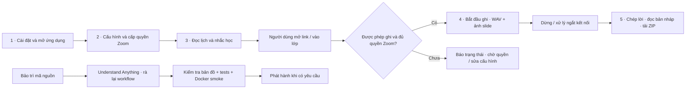

**Điểm cần nhớ:** bản Windows tự mở link lớp, bản Docker chỉ đưa link tới giao diện; cả hai đều không tự vào phòng hoặc tự ghi. Ghi cần OAuth/OBF, người cấp quyền có mặt và host cho phép. Bản Linux đã kiểm tra build/SDK init; OAuth và ghi phòng thật chưa được xác minh. RTMS chưa có.

## Các luồng và bước thực hiện

### Cài đặt và vận hành

Chạy ứng dụng local trên Windows hoặc Docker, giữ dữ liệu qua nâng cấp và kiểm tra bản phát hành. Có workflow riêng cho triển khai portal thủ công khi đủ cấu hình, nhưng chưa xác nhận đã chạy Cloudflare production; pipeline exe mặc định chưa tạo bản thương mại.

<details>
<summary>Khởi động Docker và kiểm tra bộ ghi</summary>

Khởi tạo môi trường container và giữ giao diện hoạt động khi thiếu SDK; build/init chưa chứng minh ghi phòng thật.

**Bắt đầu:** docker compose up -d --build

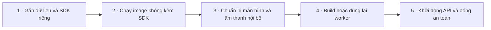

| Bước | Thực hiện | Mã nguồn |
| --- | --- | --- |
| 1. Gắn dữ liệu và SDK riêng | Compose chỉ công bố cổng loopback, volume dữ liệu bền vững và SDK mount chỉ đọc; bỏ capabilities. | [compose.yaml](../compose.yaml#L5) |
| 2. Chạy image không kèm SDK | Image chứa runtime/compiler và nguồn ứng dụng, chạy UID 10001; dữ liệu ở /data. | [Dockerfile](../Dockerfile#L11) |
| 3. Chuẩn bị màn hình và âm thanh nội bộ | Supervisor tạo Xvfb/PulseAudio và nguồn âm ảo trong container. | [scripts/container_entry.py](../scripts/container_entry.py#L10) |
| 4. Build hoặc dùng lại worker | Băm SDK/header/nguồn worker; build lỗi hoặc thiếu SDK xóa worker để tránh dùng sai nhưng vẫn chạy UI. | [scripts/container_entry.py](../scripts/container_entry.py#L46) |
| 5. Khởi động API và đóng an toàn | Tạo mật khẩu local, gắn notifier, khởi động dịch vụ; SIGTERM/SIGINT đưa qua Service.stop. | [src/container_main.py](../src/container_main.py#L13) |

</details>

<details>
<summary>Mở và nâng cấp Windows</summary>

Giữ dữ liệu cũ của cùng máy, chạy một cửa sổ/tray và cài SDK riêng của người dùng.

**Bắt đầu:** CunZoom.exe

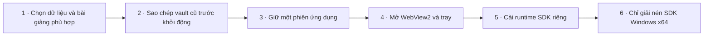

| Bước | Thực hiện | Mã nguồn |
| --- | --- | --- |
| 1. Chọn dữ liệu và bài giảng phù hợp | Chọn thư mục theo nền tảng, tái dùng vị trí bản 1.x; container cố định theo mount cấu hình. | [src/paths.py](../src/paths.py#L11) |
| 2. Sao chép vault cũ trước khởi động | Bản desktop chỉ sao chép vault 1.x khi đích chưa tồn tại; điểm vào có --no-migrate cho kiểm thử. | [src/paths.py](../src/paths.py#L44) |
| 3. Giữ một phiên ứng dụng | Điểm vào nâng cấp trước dịch vụ; mutex Windows yêu cầu bản đang chạy hiện lại cửa sổ. | [src/main.py](../src/main.py#L72) |
| 4. Mở WebView2 và tray | Cửa sổ local mở trang bằng khóa khởi chạy riêng (tài khoản khác trên máy không lấy được token từ loopback), chọn thư mục/SDK, thông báo và tray; đóng chỉ ẩn, Thoát dừng dịch vụ. | [src/main.py](../src/main.py#L98) |
| 5. Cài runtime SDK riêng | Kiểm tra thư mục do app quản lý và bot đã dừng trước chọn ZIP; staging thay SDK có phục hồi. | [src/server.py](../src/server.py#L295) |
| 6. Chỉ giải nén SDK Windows x64 | ZIP cần x64/bin/sdk.dll; chặn đường dẫn vượt đích, không thực thi nội dung. | [src/sdk_setup.py](../src/sdk_setup.py#L12) |

</details>

<details>
<summary>Rà bản đồ, kiểm tra và phát hành</summary>

CI kiểm tra nguồn/bản đồ, tests Python và Worker/D1, Windows có SDK thì build/self-test, rồi Docker smoke; publish chỉ khi được bật. Chưa có job deploy portal hay truyền accounts-url khi build exe.

**Bắt đầu:** push main; pull_request; workflow_dispatch

```mermaid
flowchart LR
  s1["1 · Rà nguồn rồi refresh bản đồ"]
  s2["2 · Theo quy tắc bàn giao nguồn và sơ đồ"]
  s1 --> s2
  s3["3 · Chặn nguồn/bản đồ lệch và chạy tests"]
  s2 --> s3
  s4["4 · Kiểm tra Windows và lấy SDK riêng"]
  s3 --> s4
  s5["5 · Build và self-test exe không SDK"]
  s4 --> s5
  s6["6 · Build Docker rồi kiểm tra HTTP thật"]
  s5 --> s6
  s7["7 · Chặn phiên bản sai hoặc tag trùng"]
  s6 --> s7
  s8["8 · Đẩy image và tạo Release"]
  s7 --> s8
```

| Bước | Thực hiện | Mã nguồn |
| --- | --- | --- |
| 1. Rà nguồn rồi refresh bản đồ | refresh nhận graph đã rà, gọi validator gốc và tái tạo graph/tài liệu/fingerprint; check phát hiện drift. | [scripts/workflow_map.py](../scripts/workflow_map.py#L334) |
| 2. Theo quy tắc bàn giao nguồn và sơ đồ | AGENTS yêu cầu fresh scan, dashboard kiểm tra chi tiết bước, nguồn/graph cùng bàn giao; dữ liệu tạm không commit. | [AGENTS.md](../AGENTS.md#L5) |
| 3. Chặn nguồn/bản đồ lệch và chạy tests | CI kiểm tra nguồn, workflow_map check, unittest, cú pháp JS, rồi Node 24/npm ci và Worker/D1 tests. | [.github/workflows/docker-release.yml](../.github/workflows/docker-release.yml#L22) |
| 4. Kiểm tra Windows và lấy SDK riêng | Windows tests luôn chạy; tải SDK từ release riêng với checksum. Thiếu SDK có thể bỏ build trong CI thường, nhưng publish phải thất bại. | [.github/workflows/docker-release.yml](../.github/workflows/docker-release.yml#L44) |
| 5. Build và self-test exe không SDK | Biên dịch worker, package, kiểm tra SDK ngoại vi, mã hóa/HTTPS/study và từ chối bundle SDK; lưu artifact. | [.github/workflows/docker-release.yml](../.github/workflows/docker-release.yml#L89) |
| 6. Build Docker rồi kiểm tra HTTP thật | Build image không SDK, chạy non-root và smoke xác thực/CSRF/mã hóa/restart; diagnostics khi lỗi. | [.github/workflows/docker-release.yml](../.github/workflows/docker-release.yml#L118) |
| 7. Chặn phiên bản sai hoặc tag trùng | Khi dispatch publish, đối chiếu input với paths.VERSION và từ chối tag đã tồn tại. | [.github/workflows/docker-release.yml](../.github/workflows/docker-release.yml#L146) |
| 8. Đẩy image và tạo Release | Chỉ publish khi bật cờ; đẩy version/latest, lấy Windows artifact, đóng gói source/checksum và tạo GitHub Release. | [.github/workflows/docker-release.yml](../.github/workflows/docker-release.yml#L164) |

</details>

<details>
<summary>Sao lưu, khôi phục và cập nhật thủ công</summary>

Người vận hành dừng ghi/xử lý, giữ cả dữ liệu và khóa rồi đổi source/image; chưa có job sao lưu tự động.

**Bắt đầu:** docs/OPERATIONS.md

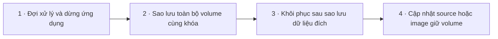

| Bước | Thực hiện | Mã nguồn |
| --- | --- | --- |
| 1. Đợi xử lý và dừng ứng dụng | Dừng ghi, đợi chép lời rồi dừng container để có bản sao nhất quán. | [docs/OPERATIONS.md](../docs/OPERATIONS.md#L56) |
| 2. Sao lưu toàn bộ volume cùng khóa | Đóng gói /data gồm vault, khóa, mô hình, cấu hình và lessons; bản sao giữ riêng. | [docs/OPERATIONS.md](../docs/OPERATIONS.md#L61) |
| 3. Khôi phục sau sao lưu dữ liệu đích | Khôi phục có thể ghi đè; cần đúng khóa Linux, không chuyển thẳng vault DPAPI Windows sang Linux. | [docs/OPERATIONS.md](../docs/OPERATIONS.md#L72) |
| 4. Cập nhật source hoặc image giữ volume | Đọc release, backup, cập nhật và tạo lại container; không xóa volume; SDK thay riêng khi bot dừng. | [docs/OPERATIONS.md](../docs/OPERATIONS.md#L84) |

</details>

<details>
<summary>Chuẩn bị và triển khai portal bằng GitHub Actions</summary>

Workflow_dispatch riêng kiểm thử, sinh cấu hình công khai, migration, deploy, nạp secrets và kiểm tra health. Đây là quy trình đã viết; Cloudflare credentials còn thiếu, chưa chạy production hoặc nghiệm thu OTP thật.

**Bắt đầu:** workflow_dispatch: .github/workflows/accounts-deploy.yml

```mermaid
flowchart LR
  s1["1 · Đọc trạng thái bàn giao trước tiếp tục"]
  s2["2 · Dispatch theo môi trường production riêng"]
  s1 --> s2
  s3["3 · Cài dependency và kiểm tra secret bắt buộc"]
  s2 --> s3
  s4["4 · Sinh cấu hình công khai từ biến đã kiểm tra"]
  s3 --> s4
  s5["5 · Dry-run, migration rồi deploy"]
  s4 --> s5
  s6["6 · Nạp secrets qua stdin"]
  s5 --> s6
  s7["7 · Kiểm tra health và giữ nghiệm thu thật riêng"]
  s6 --> s7
```

| Bước | Thực hiện | Mã nguồn |
| --- | --- | --- |
| 1. Đọc trạng thái bàn giao trước tiếp tục | Claude Code đọc AGENTS, đặc tả bàn giao và tài khoản; phân biệt mã/test local với production, giữ khác biệt Word về offline và dừng ghi chờ quyết định. | [CLAUDE.md](../CLAUDE.md#L1) |
| 2. Dispatch theo môi trường production riêng | Workflow không tự chạy khi push; dùng environment accounts-production, concurrency không cancel, vars công khai và secret Cloudflare. | [.github/workflows/accounts-deploy.yml](../.github/workflows/accounts-deploy.yml#L1) |
| 3. Cài dependency và kiểm tra secret bắt buộc | Node 24/npm ci/test chạy trước; kiểm thiếu Cloudflare và OTP/admin/Resend bindings mà không in giá trị. | [.github/workflows/accounts-deploy.yml](../.github/workflows/accounts-deploy.yml#L26) |
| 4. Sinh cấu hình công khai từ biến đã kiểm tra | Script kiểm HTTPS origin, UUID D1, sender, download HTTPS và tên worker ASCII; ghi cấu hình ignored .wrangler/production.json, SMS tắt, không ghi credentials. | [accounts/configure-production.mjs](../accounts/configure-production.mjs#L7) |
| 5. Dry-run, migration rồi deploy | Sau sinh config, workflow dry-run bundle, áp dụng migration remote và deploy. Mã workflow không là bằng chứng đã chạy thật. | [.github/workflows/accounts-deploy.yml](../.github/workflows/accounts-deploy.yml#L48) |
| 6. Nạp secrets qua stdin | Worker secrets lấy từ GitHub environment, truyền JSON vào wrangler secret bulk qua pipe; không đặt giá trị lên argv. | [.github/workflows/accounts-deploy.yml](../.github/workflows/accounts-deploy.yml#L54) |
| 7. Kiểm tra health và giữ nghiệm thu thật riêng | Fetch origin/health không redirect, timeout 15s, yêu cầu product đúng; health đạt vẫn cần OTP/thanh toán thủ công/thiết bị/revoke nghiệm thu riêng. | [.github/workflows/accounts-deploy.yml](../.github/workflows/accounts-deploy.yml#L68) |

</details>

### Tài khoản và bản quyền

Portal Workers/D1 phục vụ OTP, phiên, đơn đặt mua chờ người bán duyệt, gói, key dùng một lần và quản lý thiết bị; trang /admin cho người bán duyệt đơn, cấp gói và xem số liệu. Đây là mã và kiểm thử local; chưa chạy production, chưa gửi OTP thật, chưa có thanh toán tự động.

<details>
<summary>Cấu hình dịch vụ tài khoản và bản thương mại</summary>

Portal hiện mới có cấu hình mẫu; triển khai production, gửi OTP thật và exe thương mại cần cấu hình/thử riêng. Website chỉ phục vụ màn tài khoản.

**Bắt đầu:** configure-production.mjs; workflow_dispatch accounts-deploy.yml; build.py --accounts-url

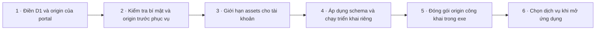

| Bước | Thực hiện | Mã nguồn |
| --- | --- | --- |
| 1. Điền D1 và origin của portal | wrangler dùng assets run_worker_first; D1 ID đang là placeholder, localhost origin và SMS tắt. Đây chưa phải production đã cấu hình. | [accounts/wrangler.jsonc](../accounts/wrangler.jsonc#L1) |
| 2. Kiểm tra bí mật và origin trước phục vụ | Worker yêu cầu OTP_SECRET/ADMIN_TOKEN đủ dài, origin HTTPS ngoài local và Host khớp; lỗi cấu hình trả 503. | [accounts/worker.mjs](../accounts/worker.mjs#L26) |
| 3. Giới hạn assets cho tài khoản | Worker chỉ cho trang tài khoản/account.js/account.css/logo và health; không mở giao diện app đầy đủ trên website. | [accounts/worker.mjs](../accounts/worker.mjs#L370) |
| 4. Áp dụng schema và chạy triển khai riêng | package cung cấp migration local/remote và deploy; workflow riêng tổ chức việc chạy chúng khi được dispatch. Chưa xác nhận các lệnh đã chạy production. | [accounts/package.json](../accounts/package.json#L5) |
| 5. Đóng gói origin công khai trong exe | Chỉ --accounts-url hợp lệ mới tạo accounts-config.json và thêm vào bundle; CI hiện gọi build.py không truyền tùy chọn này. | [scripts/build.py](../scripts/build.py#L12) |
| 6. Chọn dịch vụ khi mở ứng dụng | Exe frozen dùng origin đóng gói; source/Docker có thể dùng biến môi trường. Không có cấu hình thì bản cộng đồng không bật chốt license. | [src/account_client.py](../src/account_client.py#L27) |

</details>

<details>
<summary>Đăng nhập OTP và quản lý phiên</summary>

Hành vi đang triển khai là OTP không mật khẩu: tạo/xác minh danh tính email hoặc SĐT rồi dùng phiên 7 ngày. Đây chưa phải quyết định sản phẩm cuối cùng hay bằng chứng gửi OTP thật.

**Bắt đầu:** POST /api/otp/request; /api/otp/verify; /api/logout

```mermaid
flowchart LR
  s1["1 · Nhập danh tính ở website hoặc app"]
  s2["2 · Giới hạn gửi OTP và ngân sách"]
  s1 --> s2
  s3["3 · Tạo OTP có hạn và vô hiệu mã cũ"]
  s2 --> s3
  s4["4 · Gửi qua nhà cung cấp khi đã cấu hình"]
  s3 --> s4
  s5["5 · Giới hạn thử và tiêu thụ OTP nguyên tử"]
  s4 --> s5
  s6["6 · Tạo user và phiên bảy ngày"]
  s5 --> s6
  s7["7 · Giữ token desktop trong vault mã hóa"]
  s6 --> s7
  s8["8 · Thu hồi phiên và xóa đăng nhập local"]
  s7 --> s8
```

| Bước | Thực hiện | Mã nguồn |
| --- | --- | --- |
| 1. Nhập danh tính ở website hoặc app | Một UI dùng API portal/cookie hoặc proxy local desktop; email/SĐT chuẩn hóa, không có đăng nhập Google OAuth. | [web/account.js](../web/account.js#L3) |
| 2. Giới hạn gửi OTP và ngân sách | Tối đa 1/phút, 5/giờ/danh tính, 15/giờ/IP và hạn mức global/ngày; yêu cầu vẫn tính ngân sách khi gửi lỗi. | [accounts/worker.mjs](../accounts/worker.mjs#L255) |
| 3. Tạo OTP có hạn và vô hiệu mã cũ | OTP sáu số rejection sampling, HMAC gắn challenge, hết hạn 300 giây; vô hiệu challenge cũ và dọn dữ liệu hết hạn. | [accounts/worker.mjs](../accounts/worker.mjs#L264) |
| 4. Gửi qua nhà cung cấp khi đã cấu hình | Email dùng Resend, SMS Twilio chỉ khi bật/có secret; timeout 10 giây. Gửi lỗi vô hiệu challenge và báo lỗi, không trả OTP. | [accounts/worker.mjs](../accounts/worker.mjs#L60) |
| 5. Giới hạn thử và tiêu thụ OTP nguyên tử | Tăng attempts trước kiểm HMAC, tối đa năm lần; conditional update chỉ cho một yêu cầu claim được mã. | [accounts/worker.mjs](../accounts/worker.mjs#L277) |
| 6. Tạo user và phiên bảy ngày | DB chỉ giữ digest session; web nhận cookie HttpOnly/SameSite Strict/Secure trên HTTPS, desktop nhận token riêng. | [accounts/worker.mjs](../accounts/worker.mjs#L285) |
| 7. Giữ token desktop trong vault mã hóa | Proxy local yêu cầu client desktop, xác minh token, giữ device_id và license cũ khi cùng danh tính rồi mã hóa account.vault. | [src/account_client.py](../src/account_client.py#L150) |
| 8. Thu hồi phiên và xóa đăng nhập local | Worker xóa session hiện tại; client cuối cùng xóa credentials/cache và giữ device_id kể cả khi logout mạng lỗi. | [src/account_client.py](../src/account_client.py#L171) |

</details>

<details>
<summary>Cấp gói thủ công và lấy key một lần</summary>

Người bán cấp gói đúng danh tính bằng CLI hoặc trang /admin (trực tiếp, hoặc khi duyệt đơn của khách); chưa có cổng thanh toán tự động. User tự lấy key chỉ một lần, DB không giữ bản rõ.

**Bắt đầu:** node accounts/admin.mjs grant; POST /api/licenses/key

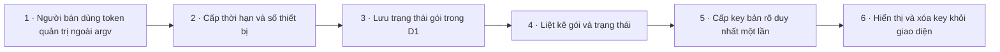

| Bước | Thực hiện | Mã nguồn |
| --- | --- | --- |
| 1. Người bán dùng token quản trị ngoài argv | CLI đọc ADMIN_TOKEN từ môi trường, kiểm origin HTTPS ngoài local và nhận grant/revoke/reissue. Trang /admin làm cùng việc bằng phiên OTP của danh tính quản trị. | [accounts/admin.mjs](../accounts/admin.mjs#L1) |
| 2. Cấp thời hạn và số thiết bị | Worker kiểm quyền quản trị (ADMIN_TOKEN hoặc phiên quản trị), danh tính, 1–3650 ngày, 1–10 máy; tạo license chưa owner/chưa expires và audit grant kèm người thao tác. | [accounts/worker.mjs](../accounts/worker.mjs#L194) |
| 3. Lưu trạng thái gói trong D1 | Schema tách identity, key_digest duy nhất, owner, số ngày, số máy, hạn và revoked; không có bảng thanh toán tự động. | [accounts/migrations/0001_accounts.sql](../accounts/migrations/0001_accounts.sql#L11) |
| 4. Liệt kê gói và trạng thái | /me trả gói pending/issued/active/expired/revoked, thiết bị, 20 đơn gần nhất và download_url HTTPS; tài khoản mới không tự có gói. | [accounts/worker.mjs](../accounts/worker.mjs#L296) |
| 5. Cấp key bản rõ duy nhất một lần | UPDATE có điều kiện chỉ khi đúng identity, chưa key/owner, chưa revoked; key 160 bit CZ- chỉ có trong response, DB giữ SHA-256. | [accounts/worker.mjs](../accounts/worker.mjs#L329) |
| 6. Hiển thị và xóa key khỏi giao diện | UI cho sao chép, ẩn hoặc redeem; không lưu key/token vào localStorage, pagehide/logout xóa key. Mất key trước khi kích hoạt: người bán chạy reissue (có audit) để key cũ hết hiệu lực và khách lấy key mới. | [web/account.js](../web/account.js#L34) |

</details>

<details>
<summary>Kích hoạt gói và quản lý thiết bị</summary>

Redeem một lần gắn license với user và bắt đầu hạn; các lần dùng sau kích hoạt thiết bị, không dùng lại key. Website có thể gỡ thiết bị để chuyển máy.

**Bắt đầu:** POST /api/licenses/redeem; /api/devices/activate; /api/devices/remove

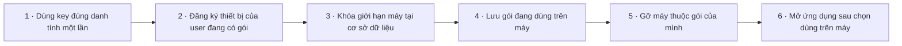

| Bước | Thực hiện | Mã nguồn |
| --- | --- | --- |
| 1. Dùng key đúng danh tính một lần | Kiểm format/key hash và owner trống bằng UPDATE có điều kiện; expires tính từ now + days. Cùng chủ sở hữu gửi lại (mất phản hồi, hai yêu cầu song song) nhận lại đúng kết quả cũ, không cộng hạn; tài khoản khác bị từ chối. | [accounts/worker.mjs](../accounts/worker.mjs#L336) |
| 2. Đăng ký thiết bị của user đang có gói | Kiểm gói còn hạn/chưa revoke, device_id và tên; INSERT/UPDATE thiết bị thuộc license của user. | [accounts/worker.mjs](../accounts/worker.mjs#L348) |
| 3. Khóa giới hạn máy tại cơ sở dữ liệu | Trigger BEFORE INSERT đếm theo license, bỏ qua máy đã tồn tại; giữ giới hạn khi hai kích hoạt đồng thời. | [accounts/migrations/0001_accounts.sql](../accounts/migrations/0001_accounts.sql#L19) |
| 4. Lưu gói đang dùng trên máy | Client lưu license_id nhận từ server, bỏ cache và xác minh trực tuyến trước trả thành công. | [src/account_client.py](../src/account_client.py#L180) |
| 5. Gỡ máy thuộc gói của mình | Worker chỉ xóa device trong license user sở hữu; UI cho danh sách từng máy và xác nhận gỡ. | [accounts/worker.mjs](../accounts/worker.mjs#L357) |
| 6. Mở ứng dụng sau chọn dùng trên máy | Chỉ desktop có nút Dùng trên máy này và luôn có nút Vào Cún Zoom; portal cung cấp tải app/gói/thiết bị, không chạy bot từ website. | [web/account.js](../web/account.js#L19) |

</details>

<details>
<summary>Kiểm tra quyền trực tuyến và thu hồi</summary>

Client bật account cần session/gói/thiết bị còn hiệu lực, cache tối đa 60 giây và làm mới ngầm. Khi chưa có quyền hoặc mất mạng sau cache, ứng dụng vẫn mở để xem, đọc, xuất, cấu hình và dừng; chỉ chặn việc trả phí mới và không cắt buổi đang ghi. Lease offline còn chờ quyết định sản phẩm.

**Bắt đầu:** POST /api/licenses/check; admin revoke; watchdog 15 giây

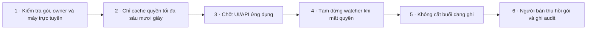

| Bước | Thực hiện | Mã nguồn |
| --- | --- | --- |
| 1. Kiểm tra gói, owner và máy trực tuyến | Worker yêu cầu session hợp lệ, owner đúng, revoked=0, expires còn hạn và device hiện diện; cập nhật last_seen, trả recheck_after 60. | [accounts/worker.mjs](../accounts/worker.mjs#L362) |
| 2. Chỉ cache quyền tối đa sáu mươi giây | Client cache theo monotonic và hạn gói; giao diện, status và vòng nền chỉ đọc cache, kiểm tra mạng chạy nền một lần mỗi lúc, lỗi thì thử lại sau 15 giây. Chỉ thao tác trả phí (require) chờ server; thiếu credentials, phản hồi sai, mạng lỗi hoặc hết hạn là chưa có quyền. | [src/account_client.py](../src/account_client.py#L94) |
| 3. Chốt UI/API ứng dụng | Account actions được truy cập trước license. Chỉ PAID_ROUTES (ghi Zoom, kiểm tra SDK, kết nối Zoom, lịch, tải model/SDK, kiểm tra AI, đồng bộ Ôn tập, tạo đề), bật theo dõi lịch và tải tài liệu lên cần bản quyền; xem, đọc, tải/xuất, cấu hình, ngắt kết nối và dừng luôn được. Trang chính luôn mở, kèm thông báo và link /account. | [src/server.py](../src/server.py#L185) |
| 4. Tạm dừng watcher khi mất quyền | Service gắn account.authorized (chỉ đọc cache) cho watcher lịch và engine ôn tập; chúng kiểm lại mỗi vòng/job, tạm dừng chép lời và AI khi chưa có quyền, không hủy yêu cầu AI đã gửi. | [src/server.py](../src/server.py#L77) |
| 5. Không cắt buổi đang ghi | Không còn watchdog: buổi đang ghi chạy tiếp đến khi người dùng dừng hoặc buổi kết thúc, kể cả khi bản quyền hết hạn hoặc mất mạng; bản chép lời của buổi đó vẫn được tạo. Khi khởi động, dịch vụ chỉ bắt đầu kiểm tra bản quyền ngầm. | [src/server.py](../src/server.py#L536) |
| 6. Người bán thu hồi gói và ghi audit | Admin revoke cập nhật revoked=1 và audit cùng batch; key chưa dùng và gói đã active đều không qua kiểm tra tiếp theo. Admin reissue chỉ xóa digest của key đã phát chưa kích hoạt và ghi audit. | [accounts/worker.mjs](../accounts/worker.mjs#L204) |

</details>

<details>
<summary>Quản trị bán hàng</summary>

Khách đặt đơn theo gói; người bán đăng nhập /admin bằng OTP để duyệt đơn (tự cấp gói), cấp/thu hồi/cấp lại mã, quản lý gói và xem doanh thu, đơn, người dùng, bản quyền theo ngày. Chưa có thanh toán tự động: người bán tự đối chiếu chuyển khoản.

**Bắt đầu:** GET /admin; POST /api/orders/create

```mermaid
flowchart LR
  s1["1 · Lưu gói bán, đơn và người thao tác"]
  s2["2 · Chỉ danh tính quản trị vào được"]
  s1 --> s2
  s3["3 · Khách chọn gói và gửi đơn"]
  s2 --> s3
  s4["4 · Duyệt hoặc từ chối đơn"]
  s3 --> s4
  s5["5 · Cấp, thu hồi và cấp lại mã trên trang"]
  s4 --> s5
  s6["6 · Quản lý gói bán"]
  s5 --> s6
  s7["7 · Tổng hợp số liệu theo ngày Việt Nam"]
  s6 --> s7
  s8["8 · Biểu đồ và bảng số liệu"]
  s7 --> s8
  s9["9 · Nhật ký thao tác"]
  s8 --> s9
```

| Bước | Thực hiện | Mã nguồn |
| --- | --- | --- |
| 1. Lưu gói bán, đơn và người thao tác | Migration 0002 thêm bảng plans và orders (mã CK duy nhất, ảnh chụp giá/số ngày/số máy lúc đặt, trạng thái pending/approved/rejected/cancelled, license đã cấp) và cột actor/detail cho audit. | [accounts/migrations/0002_orders.sql](../accounts/migrations/0002_orders.sql#L1) |
| 2. Chỉ danh tính quản trị vào được | Trang /admin đăng nhập bằng OTP như khách; Worker chỉ nhận danh tính có trong ADMIN_IDENTITIES và phiên tạo chưa quá 12 giờ. CLI vẫn dùng ADMIN_TOKEN; token sai dạng bị từ chối. | [accounts/worker.mjs](../accounts/worker.mjs#L96) |
| 3. Khách chọn gói và gửi đơn | Trang tài khoản (web hoặc desktop qua proxy) liệt kê gói đang bán; khách gửi đơn kèm ghi chú, nhận mã CK để ghi khi chuyển khoản. Tối đa 3 đơn chờ, 5 lần đặt mỗi giờ; khách tự hủy được đơn đang chờ. | [accounts/worker.mjs](../accounts/worker.mjs#L306) |
| 4. Duyệt hoặc từ chối đơn | Người bán đối chiếu mã CK với sao kê rồi duyệt: một batch D1 tạo license từ ảnh chụp đơn, chuyển đơn sang approved và ghi audit; duyệt lần hai hay song song bị 409. Từ chối lưu lý do để khách thấy. | [accounts/worker.mjs](../accounts/worker.mjs#L167) |
| 5. Cấp, thu hồi và cấp lại mã trên trang | Tab Bản quyền tìm theo danh tính/trạng thái, cấp gói trực tiếp, thu hồi gói, cấp lại mã đã phát chưa kích hoạt. Trang không bao giờ thấy mã bản rõ. | [web/admin.js](../web/admin.js#L269) |
| 6. Quản lý gói bán | Thêm, sửa, tạm ẩn gói (tên, số ngày, số máy, giá đồng). Sửa gói không đổi đơn đã đặt vì mỗi đơn giữ ảnh chụp lúc mua. | [accounts/worker.mjs](../accounts/worker.mjs#L221) |
| 7. Tổng hợp số liệu theo ngày Việt Nam | Overview gộp trong một batch: đơn theo trạng thái và ngày đặt, doanh thu theo ngày duyệt, người dùng mới, gói theo trạng thái, thiết bị hoạt động 7 ngày; cửa sổ 7/30/90 ngày tính theo UTC+7. | [accounts/worker.mjs](../accounts/worker.mjs#L128) |
| 8. Biểu đồ và bảng số liệu | Ô số liệu (đơn chờ duyệt nổi bật), cột doanh thu, cột chồng đơn theo trạng thái, đường người dùng mới, thanh ngang gói theo trạng thái. SVG thuần theo CSP, màu theo bảng đã kiểm tra mù màu, tooltip khi rê chuột, chế độ sáng/tối và bảng số liệu dưới mỗi biểu đồ. | [web/admin.js](../web/admin.js#L93) |
| 9. Nhật ký thao tác | Mọi thao tác cấp, thu hồi, cấp lại, duyệt, từ chối và lưu gói ghi người thao tác (danh tính hoặc cli) và chi tiết; tab Nhật ký xem 100 dòng gần nhất. Không ghi key, OTP hay token. | [accounts/worker.mjs](../accounts/worker.mjs#L237) |

</details>

### Truy cập local và ủy quyền Zoom

Bảo vệ API local, lưu cấu hình mã hóa và hoàn tất OAuth PKCE. Quyền tài khoản Cún Zoom, xác thực Meeting SDK và quyền ghi Zoom là các điều kiện khác nhau.

<details>
<summary>Bảo vệ giao diện và kết nối quyền Zoom</summary>

Lưu ứng dụng Zoom của chính người dùng, hoàn tất OAuth PKCE và bảo vệ token trên máy; không đồng nhất với quyền bản quyền hay quyền host ghi.

**Bắt đầu:** POST /settings/zoom; /zoom/connect; GET /oauth/callback

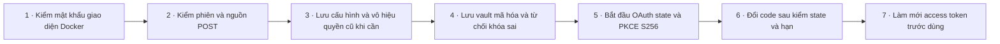

| Bước | Thực hiện | Mã nguồn |
| --- | --- | --- |
| 1. Kiểm mật khẩu giao diện Docker | Tạo mật khẩu local ngẫu nhiên bền qua restart; Docker kiểm Basic Auth username cunzoom trước nội dung riêng. | [src/access_control.py](../src/access_control.py#L12) |
| 2. Kiểm phiên và nguồn POST | Host, X-App-Token (so sánh thời gian hằng), Origin và JSON object dưới 65536 byte bắt buộc trước điều phối; upload có luồng stream riêng. Kết nối bỏ ngỏ tự đóng sau 60 giây; Windows không bật SO_REUSEADDR. | [src/server.py](../src/server.py#L475) |
| 3. Lưu cấu hình và vô hiệu quyền cũ khi cần | Kiểm ID/secret, giữ secret khi ô trống; đổi Client ID bỏ OAuth, đổi SDK credentials bỏ auth-test. | [src/server.py](../src/server.py#L214) |
| 4. Lưu vault mã hóa và từ chối khóa sai | Windows dùng DPAPI, Linux Fernet; ghi thay thế nguyên tử, không fallback bản rõ khi mất/sai khóa. | [src/vault.py](../src/vault.py#L11) |
| 5. Bắt đầu OAuth state và PKCE S256 | Desktop dùng listener loopback cổng ngẫu nhiên, Docker callback theo PUBLIC_ORIGIN; phiên 600 giây và thay phiên cũ. | [src/server.py](../src/server.py#L142) |
| 6. Đổi code sau kiểm state và hạn | Callback kiểm state/hết hạn/lỗi từ Zoom và chỉ mã hóa khi đủ access/refresh token. | [src/server.py](../src/server.py#L168) |
| 7. Làm mới access token trước dùng | Runner dùng token còn hạn hoặc refresh và lưu; thiếu quyền báo cần kết nối lại. | [src/runner.py](../src/runner.py#L53) |

</details>

### Theo dõi lịch học

Đọc Google iCal theo từ khóa, nhắc trước giờ học và chuyển link Zoom. Desktop có thể mở link; Docker chỉ phát sự kiện/link lên giao diện, người dùng tự tham gia và xác nhận ghi.

<details>
<summary>Kết nối và đồng bộ lịch</summary>

Lưu nguồn iCal của người dùng, tải có giới hạn và lọc buổi Zoom rõ ràng; lỗi không được giữ phòng cũ.

**Bắt đầu:** POST /calendar/configure; /calendar/sync

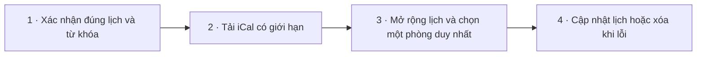

| Bước | Thực hiện | Mã nguồn |
| --- | --- | --- |
| 1. Xác nhận đúng lịch và từ khóa | Chỉ lưu khi có feed Google hợp lệ, từ khóa và account_confirmed; mã hóa rồi xóa events cũ. | [src/calendar_watch.py](../src/calendar_watch.py#L144) |
| 2. Tải iCal có giới hạn | Chỉ calendar.google.com/basic.ics HTTPS không redirect, tối đa 10 MB; lỗi chỉ giữ loại/mã, không lộ URL bí mật. | [src/calendar_watch.py](../src/calendar_watch.py#L28) |
| 3. Mở rộng lịch và chọn một phòng duy nhất | Mở rộng 14 ngày, chuẩn giờ Asia/Bangkok, bỏ cả ngày/hủy/quá hạn, lọc tiêu đề; chỉ nhận đúng một meeting_id và khử trùng. | [src/calendar_watch.py](../src/calendar_watch.py#L74) |
| 4. Cập nhật lịch hoặc xóa khi lỗi | Nếu config đổi giữa lúc tải thì bỏ kết quả; lỗi xóa events và ghi lỗi an toàn, thành công cập nhật last_sync. | [src/calendar_watch.py](../src/calendar_watch.py#L175) |

</details>

<details>
<summary>Nhắc học và chuyển link lớp</summary>

Nhắc 30 phút và tùy chọn mở link gần giờ một lần; không tự join/ghi. Watcher nền chỉ hoạt động khi account cho phép.

**Bắt đầu:** Watcher.run mỗi 15 giây; POST /calendar/open

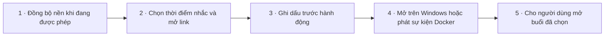

| Bước | Thực hiện | Mã nguồn |
| --- | --- | --- |
| 1. Đồng bộ nền khi đang được phép | Mỗi vòng kiểm quyền; lịch bật được tải lại sau 300 giây, tick mỗi 15 giây; lỗi báo tạm dừng. | [src/calendar_watch.py](../src/calendar_watch.py#L242) |
| 2. Chọn thời điểm nhắc và mở link | Nhắc khi còn 0–1800 giây, auto_open trong khoảng từ trước 120 tới sau 600 giây, bỏ buổi đã hết. | [src/calendar_watch.py](../src/calendar_watch.py#L207) |
| 3. Ghi dấu trước hành động | Lưu dấu remind/open vào vault trước side effect, dọn dấu cũ để restart không liên tục mở lại lớp. | [src/calendar_watch.py](../src/calendar_watch.py#L223) |
| 4. Mở trên Windows hoặc phát sự kiện Docker | platform_actions dùng os.startfile Windows; Linux phát open_url/notice cho giao diện, không mở trình duyệt ẩn trên host. | [src/platform_actions.py](../src/platform_actions.py#L11) |
| 5. Cho người dùng mở buổi đã chọn | API chỉ lấy event còn hiện hữu; Docker trả URL cho UI, desktop mở link; bắt đầu bot là thao tác xác nhận riêng. | [src/server.py](../src/server.py#L209) |

</details>

### Ghi buổi học được phép

Điều phối một worker Meeting SDK Windows/Linux, yêu cầu tham gia bằng OBF và chờ quyền host trước dữ liệu thô. Ghi WAV và ảnh chia sẻ, xử lý STOP, lỗi quyền và thoát; chưa có RTMS.

<details>
<summary>Kiểm tra SDK rồi yêu cầu vào phòng</summary>

Người dùng kiểm tra SDK, chọn phòng và xác nhận được phép ghi; server lấy OBF rồi đưa JWT/OBF qua pipe cho một worker.

**Bắt đầu:** POST /sdk-test; /parse-room; /start-bot

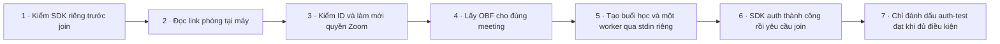

| Bước | Thực hiện | Mã nguồn |
| --- | --- | --- |
| 1. Kiểm SDK riêng trước join | /sdk-test chạy auth-test; join cần consent và auth_test_passed. Auth-test không tham gia phòng. | [src/server.py](../src/server.py#L243) |
| 2. Đọc link phòng tại máy | Chỉ HTTPS zoom.us/zoom.com, numeric 9–11 số với đường dẫn được hỗ trợ; báo link có pwd nhưng không coi pwd nhúng là mật khẩu thật. | [src/room_link.py](../src/room_link.py#L6) |
| 3. Kiểm ID và làm mới quyền Zoom | Nếu ID/link khác nhau thì từ chối; refresh OAuth trước gọi runner với subject/title và xác nhận. | [src/server.py](../src/server.py#L252) |
| 4. Lấy OBF cho đúng meeting | Gọi Zoom users/me/token type=onbehalf theo meeting_id; thiếu/từ chối token báo lỗi, không gửi access token cho native. | [src/runner.py](../src/runner.py#L62) |
| 5. Tạo buổi học và một worker qua stdin riêng | Kiểm SDK/worker, bot duy nhất, consent, ID, tên và password; tạo metadata joining chưa recording_confirmed; secrets gửi base64 qua stdin. | [src/runner.py](../src/runner.py#L89) |
| 6. SDK auth thành công rồi yêu cầu join | Native Windows init/auth và join bằng OBF, video/audio off, external mic im lặng; lỗi hoặc timeout có event riêng. | [native/bot.cpp](../native/bot.cpp#L98) |
| 7. Chỉ đánh dấu auth-test đạt khi đủ điều kiện | Runner cần SDK init, SDK auth code=0 và process exit=0; join_requested không tự thành ghi thành công. | [src/runner.py](../src/runner.py#L115) |

</details>

<details>
<summary>Xin quyền ghi, lưu dữ liệu và dừng</summary>

Native chỉ mở raw recording khi Zoom cho phép; giữ WAV/slide local và đóng an toàn khi user STOP, mất quyền ghi hoặc room ended. Bản quyền hết hạn không cắt buổi đang ghi.

**Bắt đầu:** Meeting SDK callbacks; POST /stop-bot; Service.stop

```mermaid
flowchart LR
  s1["1 · Chờ host cho raw recording"]
  s2["2 · Theo quyền/timeout của Linux"]
  s1 --> s2
  s3["3 · Lưu âm thanh hỗn hợp WAV"]
  s2 --> s3
  s4["4 · Lấy ảnh luồng chia sẻ có giới hạn"]
  s3 --> s4
  s5["5 · Lưu ảnh chia sẻ trên Linux"]
  s4 --> s5
  s6["6 · Gửi STOP và cưỡng dừng khi cần"]
  s5 --> s6
  s7["7 · Đóng raw, WAV và SDK"]
  s6 --> s7
  s8["8 · Ghi kết quả thật và chép lời khi có audio"]
  s7 --> s8
```

| Bước | Thực hiện | Mã nguồn |
| --- | --- | --- |
| 1. Chờ host cho raw recording | Windows kiểm CanStartRawRecording; xin privilege một lần khi chưa đủ quyền, thu hồi quyền đang ghi dừng raw và thoát. | [native/bot.cpp](../native/bot.cpp#L86) |
| 2. Theo quyền/timeout của Linux | Linux cũng xin quyền/stop; bị denied thoát, chờ quyền quá 300 giây hoặc admission 180 giây phải kết thúc. | [native/linux_bot.cpp](../native/linux_bot.cpp#L104) |
| 3. Lưu âm thanh hỗn hợp WAV | Chỉ khi rawStarted và dữ liệu hợp lệ; ghi PCM, sửa header định kỳ, đếm byte thực và dừng khi format/ghi lỗi; không ghi mic host. | [native/bot.cpp](../native/bot.cpp#L45) |
| 4. Lấy ảnh luồng chia sẻ có giới hạn | Windows chụp tối đa một lần/30 giây, giới hạn kích thước, đổi YUV sang JPEG và xoay theo frame. | [native/bot.cpp](../native/bot.cpp#L63) |
| 5. Lưu ảnh chia sẻ trên Linux | Linux chuyển YUV, giới hạn 1600px và 30 giây, xoay khung và nén JPEG; polling nguồn share khi rawStarted. | [native/linux_bot.cpp](../native/linux_bot.cpp#L72) |
| 6. Gửi STOP và cưỡng dừng khi cần | Runner gửi STOP qua stdin, shutdown đợi 20 giây rồi terminate/kill nếu chưa thoát; UI vẫn cho dừng khi license mất. | [src/runner.py](../src/runner.py#L71) |
| 7. Đóng raw, WAV và SDK | Native thoát khi STOP, kết thúc phòng, lỗi hoặc hạn phiên; stop raw, leave, hoàn chỉnh WAV và cleanup SDK. | [native/linux_bot.cpp](../native/linux_bot.cpp#L135) |
| 8. Ghi kết quả thật và chép lời khi có audio | Runner cập nhật ended/state/audio_bytes/slides/error; recording_confirmed chỉ khi byte>0 và chỉ khi đó tự mở transcription. | [src/runner.py](../src/runner.py#L136) |

</details>

### Bài giảng và ôn tập

Giữ dữ liệu học local, đọc bản chép lời, nhận tài liệu và dùng AI tùy chọn để hệ thống hóa từng buổi/cả môn. Tạo đề cương, đề thử và tải ZIP; kết quả AI cần đối chiếu tài liệu.

<details>
<summary>Chép lời local và bản trích ý nháp</summary>

Tải mô hình một lần, chép audio/video bằng Whisper CPU offline và tạo transcript/nháp quy tắc, không coi là bản đã đối chiếu.

**Bắt đầu:** POST /model/download; worker kết thúc có audio; Engine.scan

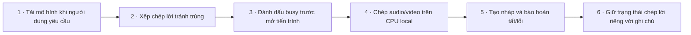

| Bước | Thực hiện | Mã nguồn |
| --- | --- | --- |
| 1. Tải mô hình khi người dùng yêu cầu | Service tải riêng các file faster-whisper-base từ Hugging Face vào cache; trạng thái downloading/ready/failed. | [src/server.py](../src/server.py#L124) |
| 2. Xếp chép lời tránh trùng | Engine chỉ chép một buổi khi có model và không đang ghi; media upload luôn chép, audio cũ cần auto; trạng thái processing có hạn stale. | [src/study.py](../src/study.py#L725) |
| 3. Đánh dấu busy trước mở tiến trình | Runner ghi trạng thái processing trước Popen; frozen dùng --transcribe, source chạy module riêng và lưu log local. Một luồng theo dõi ghi failed nếu tiến trình chép lời chết trước khi tự ghi trạng thái. | [src/runner.py](../src/runner.py#L30) |
| 4. Chép audio/video trên CPU local | Chọn audio ghi hoặc upload media, faster-whisper base int8, local_files_only và hai CPU threads; ngôn ngữ vi với timestamp. Mỗi file chỉ giải mã tối đa 3 giờ âm thanh (load_audio). | [src/transcribe.py](../src/transcribe.py#L17) |
| 5. Tạo nháp và báo hoàn tất/lỗi | Trích câu theo tần suất thành tom_tat_nhap, đánh dấu cần rà; tạo hướng dẫn đối chiếu và completed hoặc failed. | [src/transcribe.py](../src/transcribe.py#L5) |
| 6. Giữ trạng thái chép lời riêng với ghi chú | Transcript mới hơn media hoặc trạng thái completed (kể cả bản chép lời rỗng của file im lặng) là done; processing dưới sáu giờ là running; lỗi cùng nguồn là failed; model chưa có có thể dùng tài liệu khác trước. | [src/study.py](../src/study.py#L163) |

</details>

<details>
<summary>Xem và tải thư viện bài giảng</summary>

Đọc buổi học local qua ID, phân biệt ghi nhận âm thanh và tài liệu; Windows mở thư mục, Docker tạo ZIP.

**Bắt đầu:** POST /library/read; /library/open; GET /library/download

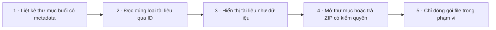

| Bước | Thực hiện | Mã nguồn |
| --- | --- | --- |
| 1. Liệt kê thư mục buổi có metadata | Chỉ lấy buổi trong root, chặn symlink/vượt root và metadata sai; trả ID băm, số ảnh/byte, có transcript/nháp hay không. | [src/library.py](../src/library.py#L11) |
| 2. Đọc đúng loại tài liệu qua ID | Chỉ transcript/summary được ánh xạ, kiểm đường dẫn trong buổi và giới hạn 160000 ký tự. | [src/library.py](../src/library.py#L49) |
| 3. Hiển thị tài liệu như dữ liệu | UI hiển thị âm thanh/ảnh hoặc reader, dựng Markdown hạn chế và textContent; không chạy nội dung bài giảng. | [web/app.js](../web/app.js#L28) |
| 4. Mở thư mục hoặc trả ZIP có kiểm quyền | Desktop mở local; Docker GET tải đã qua Basic Auth, stream zip tạm. Tải/xuất không cần bản quyền. | [src/server.py](../src/server.py#L386) |
| 5. Chỉ đóng gói file trong phạm vi | Archive không theo symlink/vượt folder, trả TemporaryFile và đóng khi lỗi. | [src/library.py](../src/library.py#L71) |

</details>

<details>
<summary>Tải tài liệu học vào buổi</summary>

Upload tài liệu vào buổi có sẵn hoặc tạo buổi chỉ có tài liệu; lưu local, không gửi lên account portal.

**Bắt đầu:** POST /study/upload

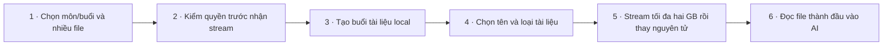

| Bước | Thực hiện | Mã nguồn |
| --- | --- | --- |
| 1. Chọn môn/buổi và nhiều file | Giao diện gửi từng file theo thứ tự; file đầu tạo lesson, file sau tái dùng lesson; hiện tiến độ và lỗi. | [web/study.js](../web/study.js#L112) |
| 2. Kiểm quyền trước nhận stream | POST upload cần Basic Auth/Host/app-token/Origin và license như các thao tác ứng dụng. | [src/server.py](../src/server.py#L475) |
| 3. Tạo buổi tài liệu local | Dùng tên đã làm sạch, chặn root/nhóm đặc biệt, tạo cấu trúc thư mục và metadata source=upload. | [src/study.py](../src/study.py#L634) |
| 4. Chọn tên và loại tài liệu | Chỉ PDF/DOCX/PPTX/ảnh/TXT/MD/media được chấp nhận, bỏ đường dẫn tên gửi vào và tránh ghi đè bằng hậu tố. | [src/study.py](../src/study.py#L649) |
| 5. Stream tối đa hai GB rồi thay nguyên tử | Dùng Content-Length, đọc mỗi chunk tối đa 1MB vào .part; rename khi hoàn tất, xóa part khi ngắt/lỗi và đánh thức engine. | [src/server.py](../src/server.py#L500) |
| 6. Đọc file thành đầu vào AI | Đọc TXT/Office/PDF có giới hạn: XML Office đọc theo luồng, không nhận DTD, tối đa 200 MB XML và 4 triệu ký tự mỗi file; file lỗi hoặc không có chữ thành cảnh báo. Claude có ảnh/PDF, Ollama dùng text hoặc thử ảnh rồi fallback. | [src/documents.py](../src/documents.py#L34) |

</details>

<details>
<summary>Cấu hình AI và đồng bộ nền</summary>

AI tùy chọn mặc định tắt, dùng khóa Claude của user hoặc Ollama. Hàng đợi một job/lần, fingerprint tránh làm lại và lỗi chờ nguồn mới hoặc retry.

**Bắt đầu:** POST /ai/save; /ai/test; Engine.loop

```mermaid
flowchart LR
  s1["1 · Chọn provider và mã hóa cấu hình"]
  s2["2 · Kiểm thử kết nối bằng JSON nhỏ"]
  s1 --> s2
  s3["3 · Gửi nội dung bằng SDK Claude"]
  s2 --> s3
  s4["4 · Gửi yêu cầu tới Ollama đã chọn"]
  s3 --> s4
  s5["5 · Ưu tiên yêu cầu thủ công và chống trùng"]
  s4 --> s5
  s6["6 · Scan theo fingerprint và quyền"]
  s5 --> s6
  s7["7 · Chạy một job và giữ dấu lỗi nguồn"]
  s6 --> s7
```

| Bước | Thực hiện | Mã nguồn |
| --- | --- | --- |
| 1. Chọn provider và mã hóa cấu hình | Kiểm provider/model/key Claude hoặc URL/model Ollama, giữ key khi ô trống; public_settings chỉ trả cờ key_saved. | [src/ai_backend.py](../src/ai_backend.py#L38) |
| 2. Kiểm thử kết nối bằng JSON nhỏ | generate chọn backend khi đã enabled; test chỉ đạt khi kết quả có ok=true. | [src/ai_backend.py](../src/ai_backend.py#L97) |
| 3. Gửi nội dung bằng SDK Claude | Giới hạn tài liệu 24MB, stream với schema/effort/cache, fallback chỉ model được cấu hình; lỗi API được dịch. Chưa xác minh model/account thật bằng mã này. | [src/ai_backend.py](../src/ai_backend.py#L113) |
| 4. Gửi yêu cầu tới Ollama đã chọn | POST /api/chat với schema và num_ctx 32768; model từ chối ảnh thử lại text, trừ khi buổi chỉ có ảnh thì báo lỗi thay vì đoán. Câu trả lời giới hạn 16 MB và 1800 giây; dữ liệu sai dạng thành lỗi AI. | [src/ai_backend.py](../src/ai_backend.py#L168) |
| 5. Ưu tiên yêu cầu thủ công và chống trùng | Request kiểm AI enabled/môn hợp lệ và appendleft nếu chưa có. Đồng bộ lại xóa failed của môn và đọc lại bytes tài liệu; tạo đề thì không thử lại buổi đang lỗi. Status trả current/queued/errors. | [src/study.py](../src/study.py#L688) |
| 6. Scan theo fingerprint và quyền | Loop chờ nếu không authorized; auto xếp session, môn rồi outline theo fingerprint; môn có buổi bot đang ghi được bỏ qua tới khi ghi xong; không tự tạo đề thử. | [src/study.py](../src/study.py#L708) |
| 7. Chạy một job và giữ dấu lỗi nguồn | run_jobs kiểm authorized giữa job, thực hiện session/subject/outline/exam tuần tự. Mọi loại lỗi được nhớ theo phiên bản đầu vào để không retry vô hạn; buổi lỗi không chặn hệ thống kiến thức và đề cương của các buổi khác. | [src/study.py](../src/study.py#L784) |

</details>

<details>
<summary>Hệ thống hóa buổi và kiến thức môn</summary>

AI dùng bản chép lời, tài liệu và slide để tạo ghi chú có nguồn rồi hợp nhất theo môn; không tự chứng minh tính chính xác.

**Bắt đầu:** Engine jobs session/subject; POST /study/run kind=sync

```mermaid
flowchart LR
  s1["1 · Chọn nguồn và cảnh báo phần thiếu"]
  s2["2 · Sinh và lưu ghi chú từng buổi"]
  s1 --> s2
  s3["3 · Tổng hợp kiến thức theo môn"]
  s2 --> s3
  s4["4 · Tạo mục lục tổng khi dữ liệu đổi"]
  s3 --> s4
  s5["5 · Đọc trạng thái và các tầng kiến thức"]
  s4 --> s5
```

| Bước | Thực hiện | Mã nguồn |
| --- | --- | --- |
| 1. Chọn nguồn và cảnh báo phần thiếu | Dấu vân tay nhanh theo tên/kích thước/mtime; ghi chú mới lưu thêm digest nội dung của bản chép lời và tài liệu (slide và media theo metadata), đọc lại bytes khi khởi động hoặc Đồng bộ lại. Báo chép lời lỗi/thiếu; không có nội dung đọc được thì báo lỗi, không gọi AI; Claude chọn tối đa 20 slide, Ollama báo bỏ slide. | [src/study.py](../src/study.py#L295) |
| 2. Sinh và lưu ghi chú từng buổi | Nếu quá giới hạn thì chia bản chép lời và từng tài liệu thành đoạn giữ đủ ký tự (mỗi đoạn tài liệu mang tên tài liệu), ảnh/PDF đi cùng phần đầu, rồi gộp theo tầng cho tới khi vừa một yêu cầu. Tổ chức theo liên quan/độ khó, lưu JSON/MD (chặn ảnh và HTML do AI chèn) với fingerprint, digest nội dung, model, file và cảnh báo. | [src/study.py](../src/study.py#L331) |
| 3. Tổng hợp kiến thức theo môn | Dùng các buổi đã có notes (theo digest nội dung khi có), gộp trùng theo chủ đề/quan hệ; chia lô khi cần rồi lưu hệ thống JSON/MD có fingerprint nguồn. | [src/study.py](../src/study.py#L400) |
| 4. Tạo mục lục tổng khi dữ liệu đổi | Liệt kê môn/buổi/ghi chú, liên kết hệ thống/đề cương và số đề thử; chỉ ghi khi nội dung mới. | [src/study.py](../src/study.py#L614) |
| 5. Đọc trạng thái và các tầng kiến thức | API overview/subject trả trạng thái nguồn, map/outline/exam và từng buổi; UI lọc độ liên quan/độ khó/từ khóa bằng text. | [web/study.js](../web/study.js#L28) |

</details>

<details>
<summary>Tạo đề cương, đề thử và tự ôn</summary>

Từ kiến thức môn đã có tạo đề cương và đề thi thử, lưu JSON/Markdown local. Trắc nghiệm chấm trong trình duyệt; tự luận có gợi ý chấm, chưa có lịch sử điểm server.

**Bắt đầu:** POST /study/run kind=outline/exam; /study/exam; /study/open

```mermaid
flowchart LR
  s1["1 · Kiểm yêu cầu tạo nội dung ôn tập"]
  s2["2 · Sinh đề cương từ hệ thống môn"]
  s1 --> s2
  s3["3 · Sinh đề thử theo số câu và độ khó"]
  s2 --> s3
  s4["4 · Làm bài và chấm trắc nghiệm ở UI"]
  s3 --> s4
  s5["5 · Đọc bản tổng hợp hoặc tải ZIP"]
  s4 --> s5
```

| Bước | Thực hiện | Mã nguồn |
| --- | --- | --- |
| 1. Kiểm yêu cầu tạo nội dung ôn tập | API kiểm loại và mức mix rồi xếp job; thư mục/tải ôn tập qua luồng riêng theo nền tảng. | [src/server.py](../src/server.py#L317) |
| 2. Sinh đề cương từ hệ thống môn | Cần knowledge_map, yêu cầu mục tiêu/chương/trọng tâm/kế hoạch, lưu base fingerprint và JSON/Markdown. | [src/study.py](../src/study.py#L436) |
| 3. Sinh đề thử theo số câu và độ khó | Giới hạn 0–60 trắc nghiệm, 0–10 tự luận, ít nhất một câu; câu chỉ ghi tên chủ đề được đổi thành câu hỏi, loại câu chỉ ghi số hoặc thiếu bốn lựa chọn, thiếu câu thì hỏi thêm một lần; lưu ID timestamp. | [src/study.py](../src/study.py#L473) |
| 4. Làm bài và chấm trắc nghiệm ở UI | Lưu lựa chọn trong trạng thái JS, nộp hiện đúng/sai/giải thích và số câu đúng; tự luận chỉ textarea/gợi ý, chưa lưu kết quả server. | [web/study.js](../web/study.js#L86) |
| 5. Đọc bản tổng hợp hoặc tải ZIP | Desktop mở thư mục ôn tập; Docker trả URL tải, GET có Basic Auth và chỉ đóng gói dữ liệu trong môn; không cần bản quyền. | [src/server.py](../src/server.py#L410) |

</details>

## Mở bản đồ tương tác

- Dữ liệu luồng: [domain-graph.json](../.ua/domain-graph.json).
- Kiến trúc cấp file, quan hệ import Python và các điểm nối đã rà: [knowledge-graph.json](../.ua/knowledge-graph.json). Chưa phân tích toàn bộ hàm/call graph.
- Công cụ: [fork Understand Anything được chỉ định](https://github.com/Thequancute215-sys/understand-anything), phiên bản/commit trong [tooling.json](../.ua/tooling.json).

Cài ba skill `understand`, `understand-domain`, `understand-dashboard` từ repo đó theo hướng dẫn của nó. Gọi `understand-dashboard` với đường dẫn bản clone Cún Zoom. Dùng URL đầy đủ có `?token=` mà dashboard in ra; token chỉ dùng local, không commit.

Trong dashboard: chọn **Domain**, bấm một miền rồi chọn luồng trong bảng chi tiết, bấm một bước để đọc giải thích; chọn **Structural** để xem các file liên quan.

## Cập nhật bắt buộc sau mỗi thay đổi

1. Đọc [AGENTS.md](../AGENTS.md), graph hiện tại và nguồn bị ảnh hưởng.
2. Dùng skill `understand-domain --full` trong checkout của fork được ghim. Chạy script `extract-domain-context.py` theo skill, giao domain-analyzer rà dữ liệu với mã thật. Lưu phân tích mới ở `.ua/intermediate/domain-analysis.json`. Không lấy graph cũ rồi chỉ đổi ngày.
3. Build core của công cụ một lần (`pnpm install --frozen-lockfile --ignore-scripts`, rồi `pnpm --filter @understand-anything/core build` từ gốc plugin). Python và Node phải có trên PATH. Chạy:

```text
python scripts/workflow_map.py refresh --plugin-root <duong-dan>/understand-anything-plugin --domain-graph .ua/intermediate/domain-analysis.json --review-note "Mo ta luong da doi va nguon da doi chieu"
python scripts/workflow_map.py check
```

4. Mở dashboard, kiểm tra luồng vừa thay đổi và ít nhất một bước. Commit nguồn, hai graph, trang này và snapshot cùng lần bàn giao. Trước khi commit phải xóa dữ liệu trung gian theo skill; không lưu link token của viewer vào Git.
5. CI chạy `check` trước tests/build; nguồn, graph hoặc tài liệu sinh ra bị lệch snapshot sẽ bị từ chối. Kiểm tra này phát hiện thay đổi nội dung, không thay thế việc phân tích ý nghĩa của thay đổi.

`.ua/config.json` đặt `autoUpdate: true` cho công cụ hỗ trợ tính năng này. Trong Codex, việc duy trì được ràng buộc bằng AGENTS và CI; không có tiến trình AI tự chạy nền chỉ nhờ cấu hình đó.

## Phạm vi dữ liệu và kiểm chứng

Graph chỉ chứa source công khai và quy trình đã thấy trong mã/hướng dẫn. SDK, dữ liệu học, iCal, token và cấu hình cá nhân không thuộc bản đồ. [VALIDATION.md](VALIDATION.md) là nguồn về kết quả kiểm thử; không coi một bước trên sơ đồ là bằng chứng thao tác đã thành công.

Ngày phân tích và commit nền nằm trong metadata của hai graph. [source-snapshot.json](../.ua/source-snapshot.json) đối chiếu chính xác nội dung nguồn đã rà, kể cả khi commit chứa thêm artifact.
